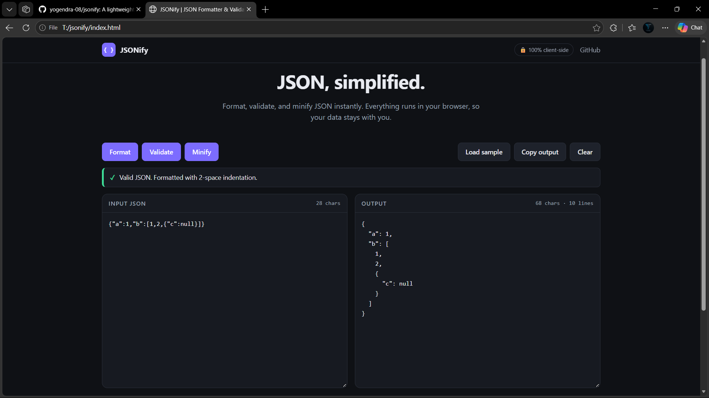

# JSONify

A lightweight, privacy-first JSON formatter, validator, and minifier. It runs entirely in your browser with no backend, no build step, and no dependencies.



## Features

- **Format** JSON with consistent two-space indentation
- **Validate** syntax with the browser's parser error details
- **Minify** JSON into compact output
- **One-click copy** with a clipboard fallback
- **Load sample** nested JSON to try it instantly
- **Live statistics** for characters and lines
- **Accessible status messages** (text + icon, announced via `aria-live`)
- **Responsive** dark UI for desktop, tablet, and mobile

## Tech Stack

HTML5, CSS3, and vanilla JavaScript (ES6+). No frameworks, packages, or build tools.

## Installation & Usage

```bash
git clone https://github.com/YOUR-USERNAME/jsonify.git
cd jsonify
```

Open `index.html` in any modern browser. No installation is needed.

1. Paste JSON into **Input JSON** (or click **Load sample**).
2. Click **Format**, **Validate**, or **Minify**.
3. Use **Copy output** to copy the result, or **Clear** to reset.

## How It Works

- **Formatting:** input is parsed with `JSON.parse()` and re-serialized with `JSON.stringify(value, null, 2)`.
- **Validation:** `JSON.parse()` either succeeds or throws; the thrown error message is shown to the user. Empty and whitespace-only input are reported separately.
- **Minification:** parsed data is serialized with `JSON.stringify(value)`, which removes all optional whitespace without changing the data.

If parsing fails, your input is never modified.

## Privacy & Security

- All processing happens locally in your browser.
- No network requests, analytics, tracking, or remote APIs.
- Output is written via `textarea.value`, never `innerHTML`.
- No `eval()` or dynamic code execution.

## Browser Compatibility

Designed for current versions of Chrome, Edge, Firefox, and Safari. The Clipboard API requires a secure context (HTTPS or `localhost`); JSONify falls back to `document.execCommand("copy")` where needed. Error message wording varies between browsers.

## Future Improvements

- Syntax highlighting
- Adjustable indentation (2/4 spaces, tabs)
- Line/column pointer for parse errors
- File upload and download
- Light theme toggle

## Contributing

See [CONTRIBUTING.md](CONTRIBUTING.md).

## License

Released under the [MIT License](LICENSE).